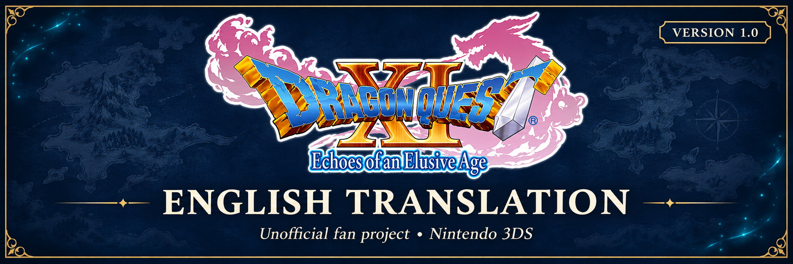
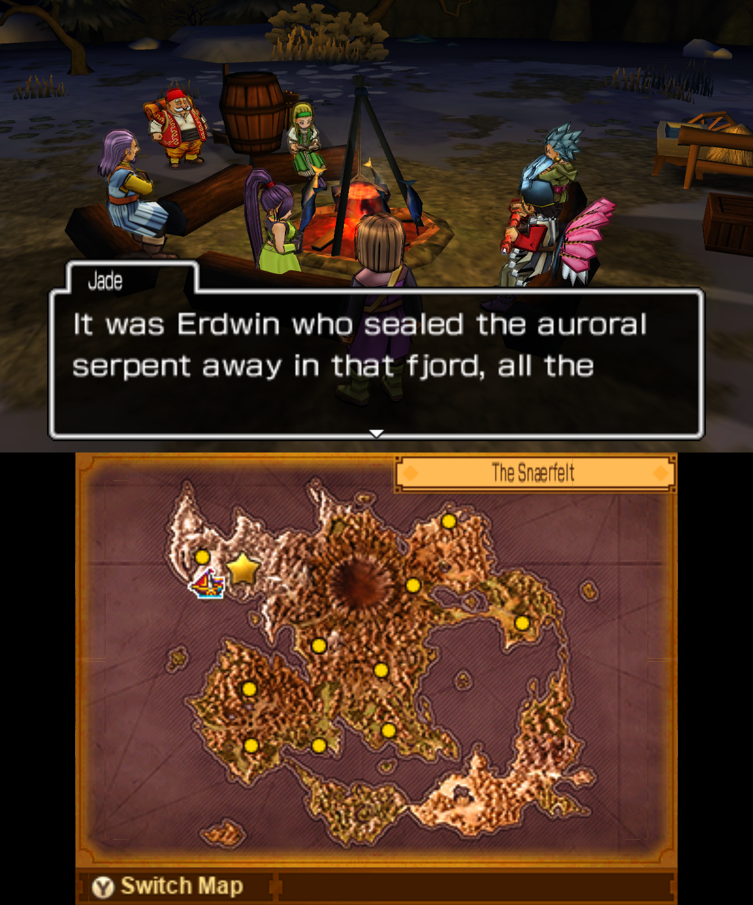
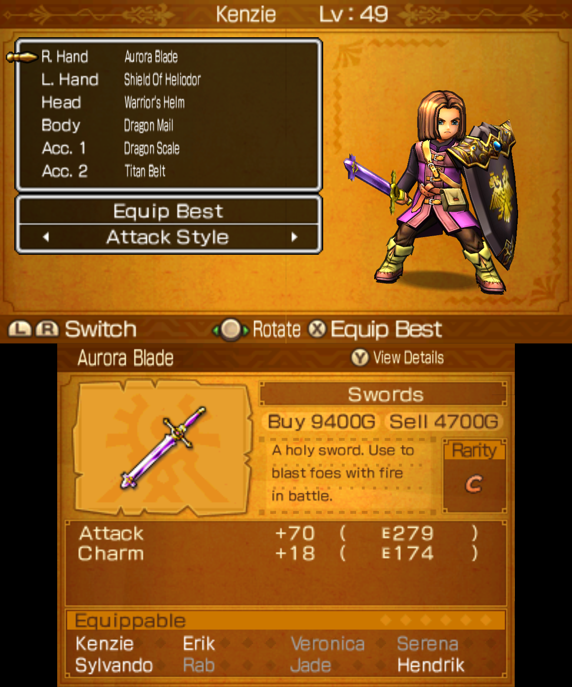
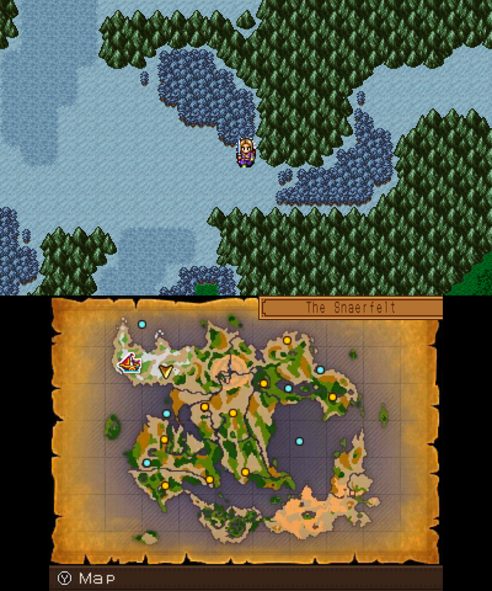
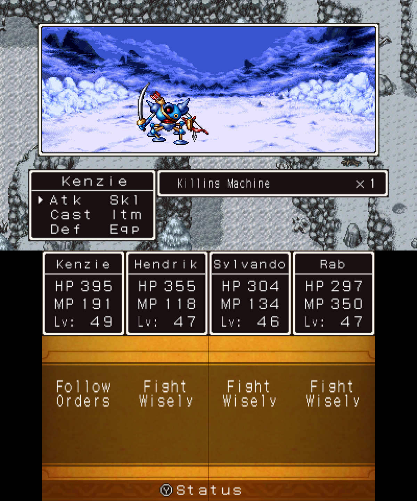

# DQXI 3DS English Patch — v1.0



An unofficial English translation patch for the Japanese Nintendo 3DS edition
of **Dragon Quest XI**, maintained by **Kenzie-1377**.

[Releases and downloads](https://github.com/Kenzie-1377/dqxi-3ds-english-patch/releases/latest)
· [Report an issue](https://github.com/Kenzie-1377/dqxi-3ds-english-patch/issues)
· [Changelog](CHANGELOG.md)

## Project status

**The translation is considered substantially complete.** The focus is now on
broader community testing and fixing issues found during play.

**If you encounter a game-breaking issue, please
[open a GitHub issue](https://github.com/Kenzie-1377/dqxi-3ds-english-patch/issues/new/choose).**
Crashes, progression blockers, broken quests, and choices that prevent progress
are especially important to report.

### Download availability

**Version 1.0 is available from the [release page](https://github.com/Kenzie-1377/dqxi-3ds-english-patch/releases/tag/1.0).**
Download the Windows builder or Linux command-line package and the matching
checksums. Both support decrypted cartridge and CIA input.

Version 1.0 includes further dialogue and UI work, improved 3D word
spacing and wrapping, two-line movie-caption repairs, English title artwork
with the changing backgrounds retained, a Heliodor rendering repair, and clean
English equipped-character labels. The title screens, equipment badge cleanup,
and Heliodor repair have received targeted player confirmation in Azahar.

Targeted tests have passed, but a complete playthrough and comprehensive
real-hardware compatibility have not been verified.
See [current status](docs/completion-status.md) and
[validation](docs/release-validation.md).

## Screenshots

Actual gameplay captured in Azahar from the current tested build.









## What you need

- Your own decrypted Japanese game, title ID **`0004000000199200`**.
- **Windows:** x64 with .NET Framework 4.8. The Windows app does not require Python.
- **Linux:** Python 3.10 or newer. Automatic native-tool downloads target x86_64.
- At least 25 GB free for ROM rebuilding, or several GB for mod-folder output.
- A compatible emulator or custom-firmware setup for the generated output.

The builder checks the required original files against their SHA-256 hashes.
An incompatible revision, already-patched input, or incompatible update will
be rejected. No ROM, keys, saves, or emulator are supplied.

## Build the translation

1. Download **`DQXI-English-Translation-Builder.exe`** and **`SHA256SUMS.txt`** from
   the [same release](https://github.com/Kenzie-1377/dqxi-3ds-english-patch/releases/latest).
   The source-code ZIP does not contain the executable.
2. Open the builder and select your decrypted Japanese game.
3. Choose a new output folder. Select **Translated .3ds file**, **Translated .cia file**, or **Mod folders**.
4. Use the verified tool download options, or provide your own supported tools.
5. Select **Build translation** and wait for successful verification.

For a translated cartridge file, use a genuine decrypted `.3ds` or `.cci` input.
A renamed `.app` or `.cxi` is not a cartridge image. The original ROM and saves
are not overwritten. Generated ROMs are decrypted/unsigned and require a
compatible setup. **CIA output requires decrypted CIA input** so the original
ticket, certificates, metadata, and unrelated contents can be preserved. Modified
CIAs require compatible custom firmware. Hardware installation still needs testing.

The executable is unsigned. Download it from this repository's release page
and verify its checksum; do not disable security software.

## Linux builder

Extract `DQXI-English-Translation-Builder-Linux-1.0.tar.gz`, open a terminal in
its folder, and run one of these commands with your own decrypted game:

```sh
./build-translation.sh --rom "/path/to/game.3ds" --output-format rom --download-ctrtool --output "/path/to/new-output"
./build-translation.sh --rom "/path/to/game.cia" --output-format cia --download-ctrtool --output "/path/to/new-output"
```

Use `--output-format mod` for mod folders. See the [Linux guide](docs/linux.md)
for requirements and local-tool options. Linux runtime testing remains pending;
Windows-hosted Python checks alone do not verify a Linux installation.

## Install or update

Close the emulator and back up your saves and current mod first. Use the
complete newly generated output rather than combining it with older patches.

- **Translated ROM:** open the generated `DQXI-English.3ds` in your compatible
  emulator. Remove conflicting external overrides for this game.
- **Translated CIA:** use the generated `DQXI-English.cia` with your compatible
  custom-firmware installation workflow. The input CIA remains unchanged.
- **Azahar mod folders:** use the game's **Mods Location** menu to find the
  correct folder, then place the generated files in this structure:

```text
load/mods/0004000000199200/
  romfs/
  exefs/
    code.ips
```

Do not copy the repository or `release/` directory into the mod folder.
Restart the emulator and load a normal in-game save rather than a save state.
Use standard timing; older experimental FPS or diagnostic patches are not part
of the current installation instructions.

## Testing and issue reports

Some names may remain cached in older saves. The patch does not rewrite saves.
Unseen dialogue, story-state differences, choices, subtitle pacing, and uncommon
layouts can still need correction. Whole-game and comprehensive real-hardware
testing have not been completed.

Please report major gameplay problems through
[GitHub Issues](https://github.com/Kenzie-1377/dqxi-3ds-english-patch/issues/new/choose).
Check existing reports first. Include the release version, emulator or hardware,
2D/3D mode, location and story state, what happened, and steps to reproduce.
A screenshot or crash message is helpful. Say whether you loaded a normal save
or a save state and whether other mods were enabled. Do not upload ROMs,
extracted game archives, or saves containing personal information.

## Development and history

The current Windows builder uses native C#/.NET Framework source in
`tools/native/`. Build it with `Build-Windows-Exe.ps1`; source builds must be
verified separately from published release assets.

See [contributing](CONTRIBUTING.md), [patching notes](docs/patching.md), and the
[changelog](CHANGELOG.md). Older release narratives, Python launcher instructions,
FPS experiments, and diagnostic workflows are preserved in the
[documentation archive](docs/archive/README-through-0.8.10.md).
Development has included AI assistance; contributions require review and testing.

## Sharing and license

Share the patch release, not generated ROMs, mod archives, extracted originals,
or private working folders. `release/` contains delta patches and their manifest.

Original code and documentation are MIT licensed; see [LICENSE](LICENSE).
That license does not grant rights to underlying game content, third-party
translations, trademarks, or assets. Dragon Quest XI and related names belong
to their respective owners. This project is not endorsed by its developers or
publishers.
